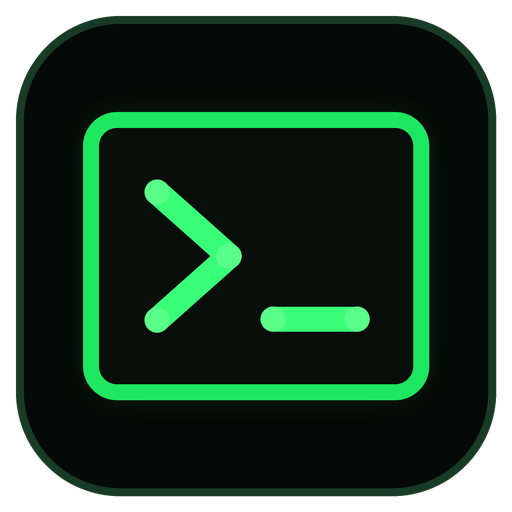

<div align="center">
  

  # Rtl Terminal

  **A Windows terminal emulator with Persian, Arabic and right-to-left text support**

  **ترمینال ویندوز با پشتیبانی از فارسی، عربی و نمایش راست‌به‌چپ**

  **محاكي طرفية لويندوز يدعم العربية والفارسية واتجاه الكتابة من اليمين إلى اليسار**

  [English](#english) · [فارسی](#فارسی) · [العربية](#العربية)

  <br>

  ## دانلود مستقیم فایل نصب · Direct Setup Download

  **آخرین نسخه مخصوص ویندوز ۱۰ و ۱۱ — بدون نیاز به نصب جداگانه .NET**

  **Latest Windows 10/11 installer — no separate .NET installation required**

  ### [⬇️ دریافت آخرین نسخهٔ منتشرشده](https://github.com/cybersec-iq/rtl-terminal/releases/latest)

  ### [⬇️ Get the latest published release](https://github.com/cybersec-iq/rtl-terminal/releases/latest)

  [GitHub · Source and releases](https://github.com/cybersec-iq/rtl-terminal)

  <br>

  

  **نمای اصلی Rtl Terminal در ویندوز · Rtl Terminal main window on Windows**
</div>

---

## English

### Rtl Terminal for Windows

**Rtl Terminal** is an open-source Windows terminal customized and maintained by **AryanIQ**, based on the MIT-licensed upstream project by **behnamapps**, for Persian, Arabic and other right-to-left language users. It provides a switchable RTL terminal view while preserving ANSI colors, interactive command-line applications, progress bars, links, Unicode text and standard terminal keyboard input.

Rtl Terminal uses the Windows ConPTY API and works with command-line environments such as Command Prompt, PowerShell, WSL, Bash, developer tools, package managers and interactive terminal applications.

### Features

- Open `View` → `Theme...` for the Theme tab in Settings. Browse the unified list with Up/Down to preview locally, then choose Apply to update all terminals. The moon button beside HTML preview switches between dark mode and Gruvbox Light.
- Pick a ready-made color scheme from Settings → Theme: AryanIQ Phosphor, Campbell, One Half, Solarized, Tango, Dracula, GitHub Dark, Nord, Gruvbox, Tokyo Night and Catppuccin. A scheme sets the default and 16 ANSI colors and switches to its matching theme.
- Start with **AryanIQ Phosphor**: black terminal background, phosphor-green default text and classic ANSI colors for shell output.
- Use the custom AryanIQ phosphor-green terminal app icon on the window and installer.
- Custom WPF cell renderer with cached visible rows and seamless block/box graphics.
- Chrome-style tabs, adjacent new-tab button, dark menus and vector window controls.
- Default terminal font size of 14; existing saved font preferences are retained.
- Apply Smart RTL per line while keeping English fragments, numbers and punctuation in their correct direction.
- Display Persian, Arabic, English and mixed Unicode terminal output.
- Support ANSI standard colors, bright colors, dim text, 256 colors and RGB colors.
- Run interactive CLI and TUI applications through Windows ConPTY.
- Toggle Codex CLI voice mode from the toolbar with one button; it sends `/voice` and `/voice stop` to the active Codex session.
- Copy the latest completed Codex response with the toolbar's **Copy report** button (the native `Ctrl+O` action).
- Send an image already on the clipboard to an image-aware interactive CLI with `Ctrl+Alt+V`, which forwards the native paste key instead of inserting a temporary file path.
- Open multiple Command Prompt, PowerShell and WSL sessions in independent tabs.
- Switch tabs with `Ctrl+Tab`, create a tab with `Ctrl+Shift+T` and close the active pane (or its last tab) with `Ctrl+Shift+W`.
- Right-click a tab and choose **Split tab** to split that tab, or **Color...** to choose its background color (including a custom color or reset).
- Split with `Ctrl+Shift+D` (side by side when wide enough, top and bottom when the selected pane is narrow); switch panes with `Ctrl+Shift+Left/Right`. Each pane shortcut can be disabled in Settings. `Ctrl+W` is passed to the terminal.
- Join an open tab using its context menu, or move a pane back to a separate tab from View. Joining is refused when the window cannot fit all panes.
- Render animated progress bars and in-place terminal line updates.
- Keep long-running AI agent output responsive with incremental scrollback rendering.
- Choose a 2,000, 5,000 or 10,000-line scrollback history limit in Font settings.
- Detect `http://`, `https://` and `www.` links and open them with `Ctrl + Click`.
- Copy selected text with `Ctrl+C` or `Ctrl+Shift+C`.
- Select all retained terminal text with `Ctrl+A` or `Ctrl+Shift+A`.
- Paste text, copied file paths and clipboard images with `Ctrl+V`, `Ctrl+Shift+V` or right-click.
- In PowerShell, use `Shift+Enter` to add a line without submitting the command. `Ctrl+Z`, `Ctrl+Y` and `Ctrl+X` are passed to the active shell for its own line-editing behavior.
- Drop files, folders, images or text onto a terminal pane to paste into that pane, including when another pane is active. File paths are quoted for its shell. WSL uses `wslpath` in the pane’s pinned distribution, honoring custom mount roots; paths from another WSL distribution are rejected instead of silently redirected.
- Advertise 24-bit color with `COLORTERM=truecolor` (also forwarded into WSL), so applications do not fall back to 256 colors. Capabilities are added only to each child environment; the application’s own environment is unchanged.
- Send `Ctrl+C` as an interrupt when no text is selected.
- Select any installed Windows font, font size, weight and italic style.
- Render ANSI bold and italic styles produced by terminal applications.
- Show recommended terminal and programming fonts when installed.
- Optionally add **Open in AryanIQ Rtl Terminal** to the Windows folder context menu.
- Open a terminal directly in the selected folder.
- Use **Select** beside the new-tab button to choose a working folder, name the project tab and open a new tab there. If the active terminal is running Codex CLI or Claude Code, the same agent starts in the new folder.
- Rename a tab from its right-click menu; the custom label stays with that open tab.
- Remember whether new tabs should use Command Prompt, PowerShell or WSL.
- Reopen one of the ten most recent Command Prompt directories from the File menu.
- Export the retained content of the current terminal session to a UTF-8 text file.
- Provide a built-in guide in English, Persian and Arabic.
- Check GitHub Releases for updates manually or at startup, with a per-version dismissal option.
- Use a consistent dark interface for menus, tabs and window controls.
- Support self-contained Windows releases with a bundled Unicode-aware ConPTY host.

### Screenshots

#### Main application — OpenAI Codex

The main screenshot shows a real Codex session rendering English, Persian and Arabic
inside Rtl Terminal with Smart RTL enabled.


#### Renderer test scenarios


### System Requirements

- Windows 10 version 2004 (build 19041) or newer
- Windows 11
- x64 processor for the provided release configuration

Windows 10 version 2004 (build 19041) is the minimum supported version because Rtl Terminal ships the modern Microsoft ConPTY host. Windows 7 and Windows 10 versions older than 2004 (build 19041) are not supported by the current backend.

### Installation

#### Installer

Download the latest `RtlTerminal-Setup-*-x64.exe` file from the GitHub Releases page and run it. The installer provides:

- Start Menu shortcut
- Optional desktop shortcut
- Standard Windows uninstaller
- Application icon and product metadata

#### Portable Version

Download `RtlTerminal.exe` from the release assets and run it directly. The self-contained build does not require a separate .NET installation.

### Build from Source

Requirements:

- Windows 10 version 2004 (build 19041) or newer
- .NET 8 SDK
- Visual Studio 2022 with WPF support, or the .NET CLI
- Inno Setup 6 when building the installer

Clone your published repository, then build it:

```powershell
git clone https://github.com/cybersec-iq/rtl-terminal.git
cd rtl-terminal
dotnet build RtlTerminal.csproj
```

Create a self-contained x64 release:

```powershell
dotnet publish RtlTerminal.csproj `
  -c Release `
  -r win-x64 `
  --self-contained true `
  -p:PublishSingleFile=true `
  -p:IncludeNativeLibrariesForSelfExtract=true `
  -p:PublishTrimmed=false `
  -o publish\win-x64
```

The portable executable is created at:

```text
publish\win-x64\RtlTerminal.exe
```

To publish the application and build the installer with Inno Setup:

```powershell
.\build-release.ps1
```

The installer is created in:

```text
release\RtlTerminal-Setup-<version>-x64.exe
```

### Automatic GitHub Releases

The only release version is `<Version>` in `RtlTerminal.csproj`. The application, local installer build and GitHub workflow read it automatically. Update that value, commit, and push a matching `v<version>` tag to create a GitHub Release:

```powershell
# Change <Version> in RtlTerminal.csproj, then commit and tag it.
git tag v<version>
git push origin v<version>
```

The workflow publishes one downloadable release asset:

```text
RtlTerminal-Setup-<version>-x64.exe
```

The installer includes the self-contained .NET runtime. The workflow can also be started manually from GitHub **Actions**; both triggers create or update the release for the project version. Build the installer locally with `build-release.ps1`; its version is passed to Inno Setup automatically.

### Keyboard and Mouse Shortcuts

| Action | Shortcut |
|---|---|
| Copy selected text | `Ctrl+C` or `Ctrl+Shift+C` |
| Select all retained text | `Ctrl+A` or `Ctrl+Shift+A` |
| Paste clipboard text | `Ctrl+V` or `Ctrl+Shift+V` |
| Paste copied files or images as paths | `Ctrl+V` or `Ctrl+Shift+V` |
| Paste with mouse | Right-click when no text is selected |
| Paste file or image paths by dragging | Drop files or images onto the destination terminal pane |
| Copy with mouse | Right-click selected text; the selection clears after copying |
| Open Copy/Paste menu | Context Menu (Apps) key or `Shift+F10`; opens after key release |
| Add a line in PowerShell without submitting | `Shift+Enter` |
| Shell-specific undo, redo and cut/edit actions | `Ctrl+Z`, `Ctrl+Y` and `Ctrl+X` |
| Bypass application mouse capture | Hold `Shift` while selecting or right-clicking |
| Create a tab using the default profile | `Ctrl+Shift+T` |
| Select a folder for a new tab | `Select` beside `+` |
| Switch to the next or previous tab | `Ctrl+Tab` or `Ctrl+Shift+Tab` |
| Close the active pane or its last tab | `Ctrl+Shift+W` |
| Interrupt the active command | `Ctrl+C` when no text is selected |
| Open a detected link | Hold `Ctrl` and click the blue link |
| Toggle automatic RTL detection | `View` → `Smart RTL` |
| Force RTL paragraph direction and right alignment (off by default) | `View` → `Row RTL` |
| Change terminal font or history size | `Edit` → `Font settings` |
| Export the current session | `File` → `Export session` |
| Check for updates | `Help` → `Check for updates` |
| Install or remove folder context menu | `Tools` → `Open in AryanIQ Rtl Terminal` |

### Font Support

The font settings window lists every font installed on Windows. It also includes a **Standard fonts** section for installed terminal and programming fonts such as:

- Cascadia Mono
- Cascadia Code
- Consolas
- Lucida Console
- JetBrains Mono
- Fira Code
- Source Code Pro
- IBM Plex Mono
- DejaVu Sans Mono
- Ubuntu Mono
- Hack
- Iosevka
- Nerd Fonts

Monospaced fonts are recommended for correct terminal alignment.

### Windows Context Menu

On first launch, Rtl Terminal can optionally add **Open in AryanIQ Rtl Terminal** for folders and folder backgrounds. The integration is registered for the current Windows user and can later be enabled or removed from the `Tools` menu.

On Windows 11, the current registry integration may appear under **Show more options**. Native placement in the modern Windows 11 context menu requires a packaged shell extension.

### Known Limitations

- Theme switching currently covers the main window; settings, guide and update dialogs retain their own styling. Light mode preserves explicit RGB and extended palette colors, so applications may need their own light theme for readable output.
- The terminal ships Microsoft.Windows.Console.ConPTY 1.25.260930003 in the `ConPty` directory. Keep that directory next to the executable, including for single-file publishes; the installer includes it.
- Persian combining marks and ZWNJ use grapheme widths in both ConPTY and the terminal buffer. This prevents spaces being overwritten when Codex/TUI output is repainted.
- Smart RTL wraps complete words in automatically wrapped Persian paragraphs. Explicit application line breaks, alternate screens and mouse-tracking grids are preserved. A token wider than the terminal still requires a character break.
- The eye button beside SMART RTL opens a styled HTML copy of the visible page in your default browser. Soft wraps are joined for browser word wrapping; explicit line breaks are retained. The file stays locally under the temporary RtlTerminal/Previews directory.
- Windows 7 is not supported.
- The Windows 11 modern context menu is not directly extended by the current registry integration.
- The custom WPF renderer is not the Windows Terminal rendering engine; CLI/TUI compatibility still needs application-specific testing.
- Color emoji, flags and font fallback depend on the Windows text renderer and installed fonts.
- Smart RTL uses directional spans, not a complete Unicode bidi implementation. Persian/Arabic shaping remains active when Smart RTL is off. Full-screen layouts retain their grid alignment unless **Row RTL** is enabled; this override can move application borders and does not change the application's own cursor/mouse coordinates.

### Validation and screenshot capture

```powershell
dotnet build RtlTerminal.sln -c Release
dotnet run --project tests/RtlTerminal.BufferTests -c Release
dotnet run --project tests/RtlTerminal.RenderTests -c Release
dotnet run --project tests/RtlTerminal.RenderTests -c Release -- --window-smoke
```

The optional `--window-smoke` check briefly opens a shell-free test window and
checks context-menu key down/up, maximized work-area bounds and minimize/restore.
To regenerate the two renderer-test screenshots with deterministic demo content:

```powershell
dotnet run --project tests/RtlTerminal.RenderTests -c Release -- --screenshots
```

See [renderer architecture and verification notes](docs/renderer.md).

### Project Information

- Product: **Rtl Terminal**
- Customized by: **AryanIQ**
- GitHub: **https://github.com/cybersec-iq/rtl-terminal**
- Instagram: **@AryanIQ**
- Upstream credit: **behnamapps / RtlTerminal (MIT License)**
- Technology: **C# · .NET 8 · WPF · Windows ConPTY**

### Contributing

Bug reports, compatibility reports, pull requests and translations are welcome. When reporting a terminal rendering issue, include:

- Windows version
- Command or application being executed
- Expected output
- Actual output
- Screenshot or a short screen recording
- Reproduction steps

### License

The project preserves the original MIT License. Contributions and redistribution must retain its copyright and license notice.

---

## فارسی

### ترمینال راست‌به‌چپ برای ویندوز

**Rtl Terminal** یک ترمینال متن‌باز ویندوز است که AryanIQ آن را بر پایهٔ پروژهٔ MIT سازندهٔ اصلی، behnamapps، شخصی‌سازی و نگهداری می‌کند. این برنامه با Smart RTL جهت متن فارسی و ترکیبی را خودکار مدیریت می‌کند و شبکهٔ برنامه‌های تمام‌صفحه را حفظ می‌کند و در کنار آن از رنگ‌های ANSI، برنامه‌های تعاملی خط فرمان، نوارهای پیشرفت، لینک‌ها و متن Unicode پشتیبانی می‌کند.

این برنامه با استفاده از Windows ConPTY می‌تواند محیط‌هایی مانند Command Prompt، PowerShell، WSL، Bash، ابزارهای توسعه، package managerها و برنامه‌های تعاملی ترمینال را اجرا کند.

### امکانات

- انتخاب تم روشن یا تیره از `View` → `Theme` با ذخیرهٔ انتخاب؛ حفظ رنگ‌های RGB صریح برنامه‌ها
- انتخاب طرح‌های رنگی آماده (Campbell، One Half، Solarized، Tango، Dracula، Nord، Gruvbox و دیگران) از تب `Theme` در تنظیمات؛ پیش‌نمایش با کلیدهای بالا و پایین و اعمال با `Apply`
- اعمال Smart RTL برای هر خط با حفظ جهت درست بخش‌های انگلیسی، اعداد و علائم
- نمایش متن فارسی، عربی، انگلیسی و متن‌های ترکیبی
- پشتیبانی از رنگ‌های ANSI، رنگ‌های روشن، متن کم‌رنگ، ۲۵۶ رنگ و RGB
- اجرای برنامه‌های CLI و TUI تعاملی
- Voice Codex CLI با یک دکمه روشن/خاموش می‌شود و از خود Codex برای دریافت گفتار استفاده می‌کند.
- پاسخ کامل‌شدهٔ اخیر Codex با دکمهٔ `Copy report` یا میان‌بر بومی `Ctrl+O` کپی می‌شود.
- ارسال تصویر کلیپ‌بورد به CLI تصویری با `Ctrl+Alt+V` و فرستادن کلید Paste خام، بدون درج مسیر فایل موقت.
- اجرای هم‌زمان Command Prompt، PowerShell و WSL در تب‌های مستقل
- ساخت، جابه‌جایی و بستن تب‌ها با میان‌برهای صفحه‌کلید
- پشتیبانی از progress bar و بازنویسی خروجی روی همان خط
- رندر بهینه برای خروجی‌های طولانی agent‌های هوش مصنوعی
- انتخاب ظرفیت سابقه از میان ۲۰۰۰، ۵۰۰۰ یا ۱۰۰۰۰ خط در تنظیمات فونت
- تشخیص لینک و بازکردن آن با `Ctrl + Click`
- کپی متن با `Ctrl+C` یا `Ctrl+Shift+C`
- Paste متن، مسیر فایل‌های کپی‌شده و تصویر Clipboard با `Ctrl+V`، `Ctrl+Shift+V` یا راست‌کلیک
- کشیدن و رهاکردن فایل، پوشه، تصویر یا متن روی پنل مقصد؛ آماده‌سازی مسیر متناسب با شل و تبدیل مسیر WSL با ابزار خود توزیع، همراه با بررسی یکسان‌بودن توزیع
- اعلام پشتیبانی از رنگ ۲۴ بیتی با `COLORTERM=truecolor` (در WSL هم)
- ارسال Interrupt با `Ctrl+C` در صورتی که متنی انتخاب نشده باشد
- انتخاب همه فونت‌های نصب‌شده ویندوز
- تنظیم اندازه، ضخامت و حالت ایتالیک فونت
- نمایش صحیح Bold و Italic ارسال‌شده توسط برنامه‌های ترمینال
- نمایش فونت‌های استاندارد ترمینال و برنامه‌نویسی در صورت نصب‌بودن
- افزودن اختیاری گزینه **Open in AryanIQ Rtl Terminal** به منوی راست‌کلیک پوشه‌ها
- بازکردن ترمینال مستقیماً در مسیر پوشه انتخاب‌شده
- به‌خاطرسپردن CMD، پاورشل یا WSL به‌عنوان محیط پیش‌فرض تب جدید
- دسترسی به ده مسیر اخیر CMD از منوی File
- خروجی‌گرفتن از محتوای جلسهٔ جاری در فایل متنی UTF-8
- راهنمای داخلی به زبان‌های فارسی، عربی و انگلیسی
- بررسی نسخه‌های جدید GitHub هنگام اجرا یا به‌صورت دستی
- ظاهر دارک یکپارچه برای منوها، تب‌ها و دکمه‌های پنجره

### نیازمندی‌های سیستم

- ویندوز ۱۰ نسخه 2004 (build 19041) یا جدیدتر
- ویندوز ۱۱
- پردازنده ۶۴ بیتی برای خروجی فعلی

نسخه 2004 (build 19041) ویندوز ۱۰ حداقل نسخه پشتیبانی‌شده است، زیرا برنامه از API مربوط به Windows ConPTY استفاده می‌کند. ویندوز ۷ و نسخه‌های قدیمی‌تر ویندوز ۱۰ در backend فعلی پشتیبانی نمی‌شوند.

### نصب

برای نصب معمولی، آخرین فایل `RtlTerminal-Setup-*-x64.exe` را از بخش Releases گیت‌هاب دانلود و اجرا کنید. فایل نصب دارای میان‌بر Start Menu، میان‌بر اختیاری Desktop و Uninstall استاندارد ویندوز است.

برای استفاده به‌صورت Portable، فایل `RtlTerminal.exe` را دانلود و مستقیماً اجرا کنید. نسخه self-contained به نصب جداگانه .NET نیاز ندارد.

### ساخت از سورس

ابتدا .NET 8 SDK را نصب کنید، سپس:

```powershell
git clone https://github.com/cybersec-iq/rtl-terminal.git
cd rtl-terminal
dotnet build RtlTerminal.csproj
```

برای ساخت نسخه مستقل:

```powershell
dotnet publish RtlTerminal.csproj `
  -c Release `
  -r win-x64 `
  --self-contained true `
  -p:PublishSingleFile=true `
  -p:IncludeNativeLibrariesForSelfExtract=true `
  -p:PublishTrimmed=false `
  -o publish\win-x64
```

برای ساخت فایل نصب، Inno Setup 6 را نصب کرده و فرمان زیر را اجرا کنید:

```powershell
.\build-release.ps1
```

### ساخت خودکار Release در گیت‌هاب

این مخزن با GitHub Actions فقط فایل نصب ویندوز ۶۴ بیتی را در Release قرار می‌دهد. برای انتشار، مقدار `<Version>` را در `RtlTerminal.csproj` تغییر دهید، کامیت کنید و تگ `v<version>` را پوش کنید:

```powershell
# نسخه را در RtlTerminal.csproj تغییر دهید و کامیت کنید.
git push origin v<version>
```

پس از پایان Workflow، فقط فایل Setup دارای Uninstall در بخش Releases قرار می‌گیرد و برای اجرا به نصب جداگانه .NET نیاز ندارد. اجرای دستی Workflow نیز ریلیز نسخهٔ پروژه را ایجاد یا به‌روزرسانی می‌کند.

### میان‌برها

| عملیات | میان‌بر |
|---|---|
| کپی متن انتخاب‌شده | `Ctrl+C` یا `Ctrl+Shift+C` |
| چسباندن متن | `Ctrl+V` یا `Ctrl+Shift+V` |
| چسباندن فایل یا تصویر کپی‌شده به‌صورت مسیر | `Ctrl+V` یا `Ctrl+Shift+V` |
| چسباندن با ماوس | راست‌کلیک در صورتی که متنی انتخاب نشده باشد |
| کپی با ماوس | راست‌کلیک روی متن انتخاب‌شده؛ سپس انتخاب پاک می‌شود |
| بازکردن منوی کپی و Paste | کلید Context Menu یا `Shift+F10`؛ پس از رهاکردن کلید |
| انتخاب همهٔ متن نگه‌داری‌شده | `Ctrl+A` یا `Ctrl+Shift+A` |
| رفتن به خط بعد بدون اجرای فرمان در PowerShell | `Shift+Enter` |
| میانبرهای وابسته به shell برای ویرایش/Undo/Redo | `Ctrl+X`، `Ctrl+Z` و `Ctrl+Y` |
| انتخاب متن در برنامه‌های دریافت‌کنندهٔ ماوس | نگه‌داشتن `Shift` |
| ساخت تب با پروفایل پیش‌فرض | `Ctrl+Shift+T` |
| جابه‌جایی بین تب‌ها | `Ctrl+Tab` یا `Ctrl+Shift+Tab` |
| بستن پنل فعال یا آخرین تب آن | `Ctrl+Shift+W` |
| متوقف‌کردن فرمان جاری | `Ctrl+C` در صورتی که متنی انتخاب نشده باشد |
| بازکردن لینک | نگه‌داشتن `Ctrl` و کلیک روی لینک آبی |
| فعال‌کردن تشخیص خودکار RTL | منوی `View` و گزینه `Smart RTL` |
| راست‌به‌چپ‌کردن جهت و تراز کل سطر؛ پیش‌فرض خاموش | منوی `View` و گزینه `Row RTL` |
| تغییر فونت یا ظرفیت History | منوی `Edit` و گزینه `Font settings` |
| خروجی‌گرفتن از جلسه | منوی `File` و گزینه `Export session` |
| بررسی آپدیت | منوی `Help` و گزینه `Check for updates` |
| مدیریت منوی راست‌کلیک | منوی `Tools` و گزینه `Open in AryanIQ Rtl Terminal` |

### مشارکت

گزارش باگ، پیشنهاد، ترجمه و Pull Request پذیرفته می‌شود. برای گزارش مشکلات رندر ترمینال، نسخه ویندوز، فرمان اجراشده، خروجی مورد انتظار، خروجی واقعی و مراحل بازتولید را ارسال کنید.

### مجوز

پروژه مجوز MIT سازندهٔ اصلی را حفظ می‌کند. برای بازنشر یا مشارکت، اعلان حق نشر و متن مجوز را نگه دارید.

---

## العربية

### طرفية تدعم العربية واتجاه RTL لنظام Windows

**Rtl Terminal** هو محاكي طرفية مفتوح المصدر لنظام Windows، خصصته AryanIQ اعتماداً على مشروع behnamapps الأصلي المرخص بـ MIT. يدير البرنامج اتجاه النص العربي والفارسي والمختلط باستخدام Smart RTL مع الحفاظ على شبكة التطبيقات بملء الشاشة مع دعم ألوان ANSI والنصوص Unicode والروابط وأشرطة التقدم وتطبيقات سطر الأوامر التفاعلية.

يعتمد البرنامج على Windows ConPTY، ويمكنه تشغيل Command Prompt وPowerShell وWSL وBash وأدوات المطورين ومديري الحزم وتطبيقات CLI وTUI.

### المميزات

- اختيار مظهر فاتح أو داكن من `View` → `Theme` مع حفظ الاختيار والحفاظ على ألوان RGB الصريحة
- اختيار مخططات ألوان جاهزة (Campbell وOne Half وSolarized وTango وDracula وNord وGruvbox وغيرها) من تبويب `Theme` في الإعدادات، مع معاينة قبل الضغط على `Apply`
- تطبيق Smart RTL لكل سطر مع الحفاظ على اتجاه المقاطع الإنجليزية والأرقام وعلامات الترقيم
- عرض النصوص العربية والفارسية والإنجليزية والنصوص المختلطة
- دعم ألوان ANSI والألوان الساطعة والنص الخافت و256 لوناً وألوان RGB
- تشغيل تطبيقات CLI وTUI التفاعلية
- تشغيل Command Prompt وPowerShell وWSL في علامات تبويب مستقلة
- إنشاء علامات التبويب والتنقل بينها وإغلاقها باختصارات لوحة المفاتيح
- دعم أشرطة التقدم وتحديث السطر نفسه
- تصيير تدريجي سريع لمخرجات وكلاء الذكاء الاصطناعي الطويلة
- اختيار سجل من 2000 أو 5000 أو 10000 سطر من إعدادات الخط
- اكتشاف الروابط وفتحها باستخدام `Ctrl + Click`
- نسخ النص باستخدام `Ctrl+C` أو `Ctrl+Shift+C`
- لصق النص ومسارات الملفات المنسوخة وصور Clipboard باستخدام `Ctrl+V` أو `Ctrl+Shift+V` أو زر الفأرة الأيمن
- إفلات الملفات أو المجلدات أو الصور أو النص على الجزء المقصود؛ تُجهّز المسارات حسب الصدفة، ويستخدم WSL أداة wslpath في التوزيعة المحددة مع رفض مسارات توزيعة أخرى
- الإعلان عن دعم الألوان بعمق 24 بت عبر `COLORTERM=truecolor` (وفي WSL أيضاً)
- إرسال أمر المقاطعة عند الضغط على `Ctrl+C` دون تحديد نص
- اختيار جميع الخطوط المثبتة في Windows
- تخصيص حجم الخط ووزنه ونمطه المائل
- عرض أنماط ANSI العريضة والمائلة الصادرة عن تطبيقات الطرفية
- عرض خطوط الطرفية والبرمجة المقترحة عند توفرها
- إضافة خيار **Open in AryanIQ Rtl Terminal** إلى قائمة المجلدات
- فتح الطرفية مباشرة داخل المجلد المحدد
- تذكّر CMD أو PowerShell أو WSL كبيئة افتراضية لعلامات التبويب الجديدة
- فتح أحد آخر عشرة مجلدات CMD من قائمة File
- تصدير محتوى الجلسة الحالية إلى ملف نصي UTF-8
- دليل مدمج باللغات العربية والفارسية والإنجليزية
- التحقق من تحديثات GitHub تلقائياً أو يدوياً
- واجهة داكنة متناسقة للقوائم وعلامات التبويب وأزرار النافذة

### متطلبات النظام

- Windows 10 الإصدار 2004 (build 19041) أو أحدث
- Windows 11
- معالج x64 لإصدار التوزيع الحالي

الإصدار 2004 (build 19041) من Windows 10 هو الحد الأدنى لأن البرنامج يستخدم Windows ConPTY. لا يدعم backend الحالي نظام Windows 7 أو إصدارات Windows 10 الأقدم.

### التثبيت

حمّل أحدث ملف باسم `RtlTerminal-Setup-*-x64.exe` من صفحة GitHub Releases ثم شغّله. يضيف المثبّت اختصاراً في قائمة Start واختصاراً اختيارياً على سطح المكتب ويوفر أداة إزالة قياسية.

يمكن أيضاً تنزيل النسخة المحمولة `RtlTerminal.exe` وتشغيلها مباشرة. النسخة المستقلة لا تحتاج إلى تثبيت .NET بشكل منفصل.

### البناء من المصدر

ثبّت .NET 8 SDK ثم نفّذ:

```powershell
git clone https://github.com/cybersec-iq/rtl-terminal.git
cd rtl-terminal
dotnet build RtlTerminal.csproj
```

لإنشاء إصدار مستقل:

```powershell
dotnet publish RtlTerminal.csproj `
  -c Release `
  -r win-x64 `
  --self-contained true `
  -p:PublishSingleFile=true `
  -p:IncludeNativeLibrariesForSelfExtract=true `
  -p:PublishTrimmed=false `
  -o publish\win-x64
```

لإنشاء ملف التثبيت، ثبّت Inno Setup 6 ثم شغّل:

```powershell
.\build-release.ps1
```

### إنشاء Release تلقائياً على GitHub

ينشر GitHub Actions ملف تثبيت Windows x64 فقط. غيّر قيمة `<Version>` في `RtlTerminal.csproj`، ثم احفظ التغيير في commit وادفع وسم `v<version>`:

```powershell
# غيّر النسخة في RtlTerminal.csproj ثم أنشئ commit.
git push origin v<version>
```

بعد اكتمال Workflow سيظهر ملف Setup فقط في صفحة Releases، وهو يدعم إزالة التثبيت ولا يحتاج إلى تثبيت .NET بشكل منفصل. التشغيل اليدوي من صفحة Actions ينشئ إصدار نسخة المشروع أو يحدّثه أيضاً.

### الاختصارات

| العملية | الاختصار |
|---|---|
| نسخ النص المحدد | `Ctrl+C` أو `Ctrl+Shift+C` |
| لصق النص | `Ctrl+V` أو `Ctrl+Shift+V` |
| لصق ملف أو صورة منسوخة كمسار | `Ctrl+V` أو `Ctrl+Shift+V` |
| اللصق بالفأرة | زر الفأرة الأيمن عند عدم تحديد نص |
| النسخ بالفأرة | النقر الأيمن على النص المحدد ثم إلغاء التحديد |
| فتح قائمة النسخ واللصق | مفتاح Context Menu أو `Shift+F10` بعد تحرير المفتاح |
| تحديد كل النص المحفوظ | `Ctrl+A` أو `Ctrl+Shift+A` |
| إضافة سطر في PowerShell دون تنفيذ الأمر | `Shift+Enter` |
| اختصارات تحرير السطر الخاصة بالـ shell | `Ctrl+X` و`Ctrl+Z` و`Ctrl+Y` |
| تجاوز التقاط الفأرة | اضغط باستمرار على `Shift` |
| إنشاء علامة بالبيئة الافتراضية | `Ctrl+Shift+T` |
| التنقل بين علامات التبويب | `Ctrl+Tab` أو `Ctrl+Shift+Tab` |
| إغلاق الجزء النشط أو علامته الأخيرة | `Ctrl+Shift+W` |
| مقاطعة الأمر الحالي | `Ctrl+C` عند عدم تحديد نص |
| فتح رابط | اضغط باستمرار على `Ctrl` ثم انقر على الرابط الأزرق |
| تفعيل اكتشاف RTL تلقائياً | قائمة `View` ثم `Smart RTL` |
| فرض اتجاه ومحاذاة السطر إلى اليمين؛ معطّل افتراضياً | قائمة `View` ثم `Row RTL` |
| تغيير الخط أو حجم السجل | قائمة `Edit` ثم `Font settings` |
| تصدير الجلسة الحالية | قائمة `File` ثم `Export session` |
| التحقق من التحديثات | قائمة `Help` ثم `Check for updates` |
| إدارة قائمة المجلدات | قائمة `Tools` ثم `Open in AryanIQ Rtl Terminal` |

### المساهمة

نرحب بتقارير الأخطاء والاقتراحات والترجمات وطلبات Pull Request. عند الإبلاغ عن مشكلة في عرض الطرفية، أرفق إصدار Windows والأمر المستخدم والنتيجة المتوقعة والنتيجة الفعلية وخطوات إعادة المشكلة.

### الترخيص

لا يتضمن المشروع حالياً ملف ترخيص. أضف ملف `LICENSE` مناسباً قبل نشر المشروع كمشروع مفتوح المصدر أو قبول مساهمات خارجية.

---

## Search Keywords

Rtl Terminal, RTL terminal Windows, Persian terminal emulator, Arabic terminal emulator, Farsi terminal, Windows terminal with RTL support, Persian PowerShell terminal, Arabic PowerShell terminal, RTL command prompt, WSL Persian terminal, WSL Arabic terminal, Unicode terminal Windows, ConPTY terminal emulator, C# WPF terminal, ترمینال فارسی ویندوز, ترمینال راست به چپ, ترمینال عربی, محیط خط فرمان فارسی, طرفية عربية ويندوز, محاكي طرفية RTL, دعم العربية في الطرفية
